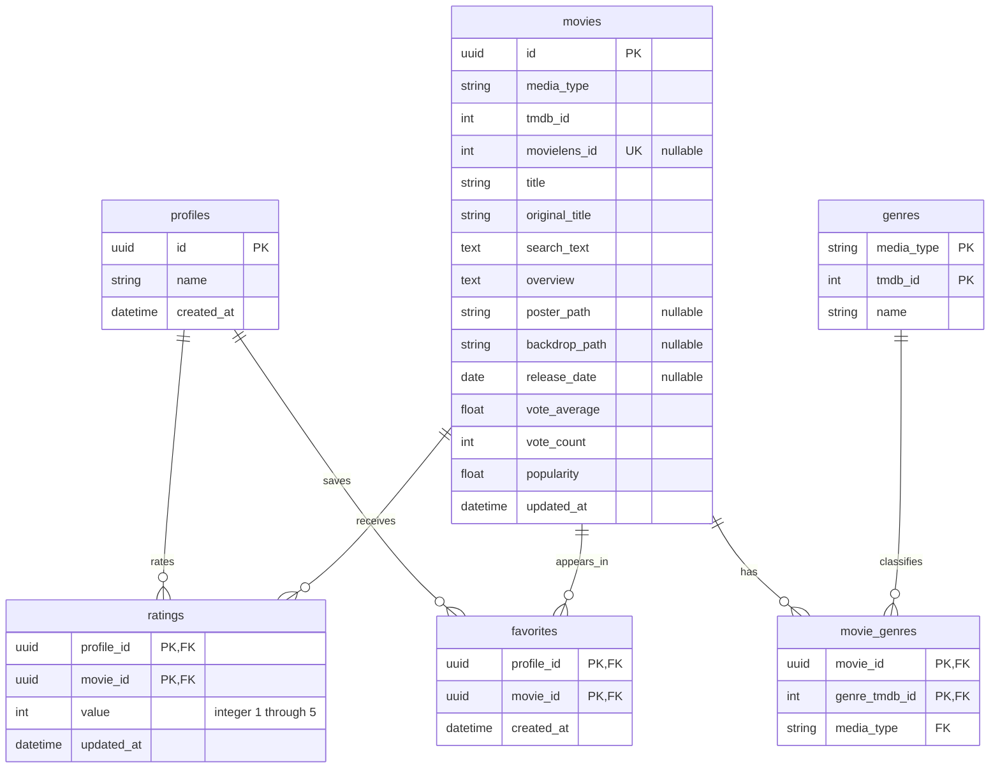

# Модель данных системы рекомендаций

Данные разделены на два независимых контура: SQLite хранит состояние приложения, а MovieLens и файлы модели используются для offline-обучения. Профиль приложения не соответствует пользователю из MovieLens. Просмотр каталога и получение рекомендаций не загружают весь внешний каталог в SQLite.

## Сущности и связи

Профиль задаёт отдельную историю предпочтений. Карточка movies описывает фильм или сериал; поле media_type различает эти типы. Оценка и избранное связывают профиль с карточкой независимо друг от друга. Жанры связаны с карточками отношением многие ко многим.

Схема показывает логические типы и состав ключей. Физическую структуру определяют ORM-модели в src/adapter/database/models и миграции Alembic в migrations/versions.

## Идентификаторы и целостность

| Таблица | Ключи и ограничения |
| --- | --- |
| profiles | UUID PK; имя после trim — от 1 до 80 символов. Имя не является уникальным идентификатором |
| movies | UUID PK; UNIQUE(media_type, tmdb_id); UNIQUE(id, media_type); nullable UNIQUE(movielens_id) |
| genres | Составной PK(media_type, tmdb_id). Один числовой ID жанра может встречаться в разных типах контента |
| movie_genres | PK(movie_id, genre_tmdb_id); составные FK(movie_id, media_type) → movies(id, media_type) и FK(media_type, genre_tmdb_id) → genres(media_type, tmdb_id) |
| ratings | PK(profile_id, movie_id); FK к профилю и карточке; CHECK целого value от 1 до 5 |
| favorites | PK(profile_id, movie_id); FK к профилю и карточке |

Составные внешние ключи movie_genres запрещают присвоить сериалу жанр из пространства фильмов. Для карточек допустимы только movie и tv, TMDB ID должен быть положительным. Средняя оценка TMDB ограничена диапазоном 0–10, число голосов и популярность неотрицательны. MovieLens ID допустим только у фильма и должен быть положительным.

Связи с профилями, карточками и жанрами имеют ON DELETE CASCADE. SQLite foreign_keys включается для каждого соединения. Повторная оценка обновляет одну запись, а повторное добавление в избранное не создаёт новую связь. Сохранение новой карточки и пользовательского действия выполняется в одной транзакции.

## Нормализация и снимки метаданных

Жанры вынесены в справочник, отношение многие ко многим — в movie_genres. В ratings и favorites хранятся ссылки, а не копии названий и описаний. Составные PK предотвращают повторение одного действия профиля над карточкой.

Поля описания, популярности и среднего рейтинга в movies являются локальным снимком TMDB на момент сохранения или обновления карточки. search_text — намеренно производное поле для локального поиска, а не отдельный первичный источник. Локальный поиск по сохранённым карточкам и внешний поиск TMDB имеют разные границы каталога.

## Данные для машинного обучения

| Контур | Содержимое | Назначение |
| --- | --- | --- |
| SQLite приложения | Профили, сохранённые карточки, жанры, оценки, избранное | Текущее состояние интерфейса и предпочтения профиля |
| Исходный MovieLens | ratings.csv, movies.csv, links.csv | Анонимная история для обучения и связи MovieLens movieId с TMDB |
| Подготовленный датасет | manifest, каталог, дисковый массив оценок | Очистка, воспроизводимое временное разделение и обучение |
| Артефакт модели | manifest.json, movies.json, similarities.npz, popularity.npy | Применение готовых сходств без чтения всех исходных оценок |

Оценки MovieLens лежат в диапазоне 0,5–5 с шагом 0,5; оценки интерфейса — целые 1–5. Модель использует положительную обратную связь ≥4 при обучении сходств, а предпочтения приложения с весами value − 3 — при подборе. В ML участвуют только фильмы. Избранное не превращается автоматически в положительную оценку.

При запросе рекомендаций сервер читает историю выбранного профиля, завершает транзакцию чтения и передаёт значения с TMDB ID в сервис рекомендаций. Анонимные MovieLens userId не записываются в profiles. Подготовленный датасет и матрица сходств не импортируются в SQLite.
