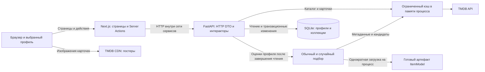
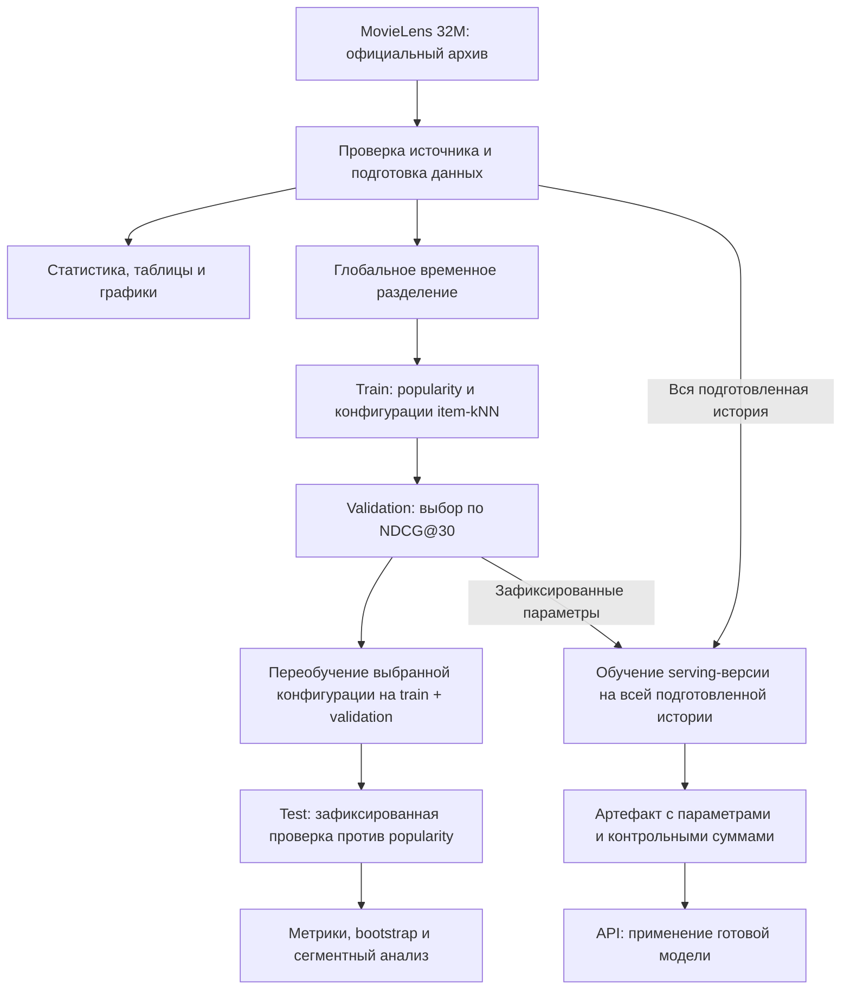
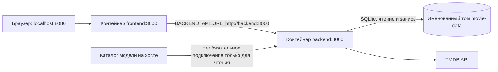

# Компоненты и потоки данных

Система состоит из Next.js-интерфейса и отдельного FastAPI-сервиса. Учебное обучение выполняется offline, а готовая модель подключается к API как необязательный артефакт.

## Работа приложения

BACKEND_API_URL используется серверной частью Next.js. Ключ TMDB принадлежит только бэкенду. Браузер хранит выбранный профиль и экранный кэш; источником сохранённых оценок и избранного является SQLite. Профили не являются системой учётных записей: текущий учебный сервис не реализует авторизацию.

Discovery и рекомендации не сохраняют найденные карточки. Запись карточки требуется при оценке, добавлении в избранное или явном импорте каталога. Кэш TMDB ограничен по размеру, времени жизни и числу запросов; он не является постоянной БД и существует отдельно в каждом процессе.

HybridRecommender объединяет ранги ItemModel и эвристики по содержанию; свободные места могут заполняться популярными фильмами. SurpriseRecommender случайно выбирает связанные и исследовательские варианты из расширенного пула. Источники имеют сроки ожидания, а API сообщает деградацию и неполные метаданные. Точные правила — в [рекомендациях](recommendations.md).

## Обучение и проверка

Test не используется для подбора параметров. Для расширенной оценки восстанавливается отдельная тестовая копия, обученная до тестовой границы; финальная serving-модель не применяется для измерения на данных, которые она уже видела. Метрики относятся к top-30 оценочной модели. Качество полной гибридной и случайной выдачи требует отдельной проверки.

Модель не обучается при каждом HTTP-запросе. Новые оценки профиля меняют вход подбора, но не переписывают матрицу сходств. Обучение, подготовка и исследование данных выполняются отдельными командами; исходные данные и большие артефакты не входят в Git или Docker-образы.

## Запуск в контейнерах

Миграции применяются перед запуском API. Фронтенд запускается после успешной проверки /ready бэкенда. Обучение не входит в запуск контейнеров. Настройки и команды приведены в [развёртывании](deployment.md), ключи и ограничения БД — в [модели данных](data-model.md).
